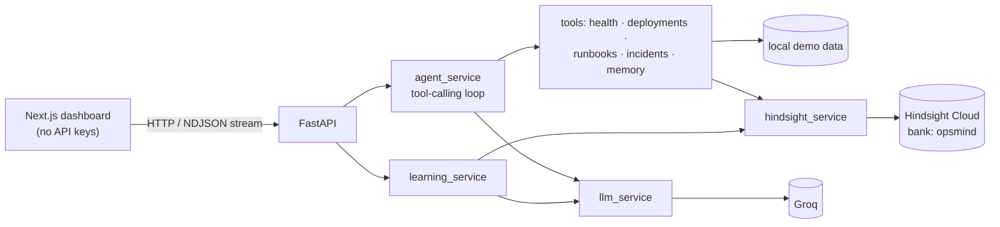
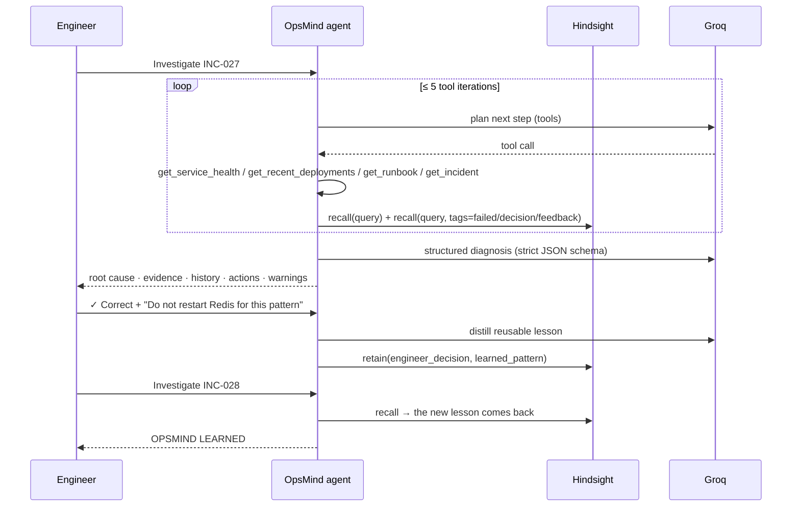

# OpsMind

> An AI incident-response agent that remembers how your infrastructure failed before, learns from engineer feedback, and uses that experience to investigate future incidents.

  

---

## What is OpsMind?

OpsMind is a single-purpose SRE copilot. When a production incident fires, it:

1. inspects **current evidence**: service telemetry, recent deployments, runbooks;
2. **recalls organizational memory from Hindsight**: past incidents, root causes, successful fixes, **failed remediation attempts**, engineer decisions;
3. produces a structured diagnosis that separates *current evidence*, *historical evidence*, *inference* and *recommendation*;
4. asks the on-call engineer **"Did OpsMind get it right?"** and **retains the correction in Hindsight**;
5. **recalls that lesson** the next time a similar incident happens.

## Why this problem matters

Most incidents are repeats. The knowledge that fixes them lives in old postmortems, Slack threads and the heads of whoever was on call last time. At 3 a.m. the runbook says *"restart Redis"*, and nobody remembers that restarting Redis made things worse in February. OpsMind turns that tribal knowledge into durable, searchable memory that improves with every incident.

## How Hindsight is used

Hindsight is the **only** memory system. There is no vector DB, no local cache of answers, and no knowledge baked into the prompt.

| Operation | Where | What |
|---|---|---|
| `acreate_bank` | seeding | Creates/updates the `opsmind` bank with a `retain_mission` that steers extraction toward incident IDs, symptoms, root causes, fixes and failed attempts |
| `aretain_batch` | seeding | 39 documents: 26 incident experiences, 6 failed approaches, 6 postmortem patterns, 1 engineer decision. Uses **stable `document_id`s + `update_mode="replace"`**, so re-seeding never duplicates |
| `arecall` | every investigation | The agent's own query **plus** a companion recall **tag-filtered** (`tags_match="any_strict"`) to `failed_approach` / `engineer_decision` / `engineer_feedback` |
| `aretain_batch` (sync) | engineer feedback | Retains an *engineer decision* + an LLM-distilled *learned lesson*, tagged `engineer_feedback`. Synchronous, so the lesson is recallable immediately |
| `banks.get_agent_stats` | header | Live memory / observation / document counts |
| `documents.list/delete` | reset | Deletes **only** OpsMind's `feedback-*` / `lesson-*` documents |

Hindsight also **consolidates observations** across memories on its own (e.g. *"payment-api experiences a recurring pattern of Redis pool exhaustion…"*). These show up in the UI as `Hindsight observation`.

All Hindsight access goes through [`backend/services/hindsight_service.py`](backend/services/hindsight_service.py). The scores shown in the UI are Hindsight's own `scores.final` values; **no similarity numbers are invented**.

## Architecture



A monolith: one FastAPI app, one Next.js app. The browser only talks to FastAPI. `GROQ_API_KEY` and `HINDSIGHT_API_KEY` never leave the backend.

## Memory model

| Category | `metadata.type` | Example |
|---|---|---|
| A. Incident experience | `incident_experience` | *INC-003 affected payment-api… Root cause: Redis connection pool exhaustion… Restarting Redis was not required.* |
| B. Engineer decisions | `engineer_decision` | *Engineer confirmed restarting Redis is not the preferred response when connections are exhausted but Redis is healthy.* |
| C. Failed approaches | `failed_approach` | *During INC-011, restarting Redis did not resolve the incident…* |
| D. Learned patterns | `learned_pattern` | *When payment-api shows Redis timeouts with connections at 100/100, investigate the application pool before restarting Redis.* |

Metadata on every memory: `type`, `incident_id`, `service`, `root_cause`, `source` (`historical_incident`, `postmortem`, `postmortem_review` or `engineer_feedback`). Tags mirror the category, so recall can filter.

The seed data contains real ambiguity. **INC-007** is a case where restarting Redis *was* correct (the Redis server itself was at 97% CPU and maxmemory). The team runbook `RB-REDIS-01` is stale and says "restart Redis". The agent has to reason from evidence: *is the Redis server healthy?*

## Agent workflow



- **Tool loop:** Groq function calling, at most **5 tool iterations** and **3 retries** per LLM call. It handles malformed JSON arguments, unknown tools and missing arguments by returning errors to the model.
- **Guardrail:** if the model never searches memory, the orchestrator runs the search and labels it `(guardrail)` in the trace.
- **Structured output:** strict `json_schema` on Groq (tools and structured outputs can't be combined, so this is a separate final step). If it fails, it falls back to `json_object` mode, then Pydantic validation with repair of near-misses (e.g. confidence `85` → `0.85`).
- **Rate-limit resilience:** each Groq model has its own tokens-per-minute bucket. When a model is rate-limited, OpsMind **fails over to the next model** instead of sleeping. The trace shows this ("Switching model (rate limit)"), and the model that actually produced each step is displayed.
- **Live trace:** `POST /api/investigate/stream` streams NDJSON events *as the work happens*. The UI never marks a step done before the backend does.

## Setup

Requirements: Python 3.11+, Node 20+, a Hindsight Cloud API key, and a Groq API key.

```bash
cp .env.example .env         # then fill in GROQ_API_KEY and HINDSIGHT_API_KEY

# backend
cd backend
python -m venv .venv && source .venv/bin/activate
pip install -r requirements.txt
cd ..

# frontend
cd frontend && npm install && cd ..
```

## Environment variables

| Variable | Default | Purpose |
|---|---|---|
| `GROQ_API_KEY` | — | Groq key (backend only) |
| `GROQ_MODEL` | `openai/gpt-oss-120b` | Diagnosis model |
| `GROQ_AGENT_MODEL` | `openai/gpt-oss-20b` | Tool-calling loop model |
| `GROQ_AGENT_FALLBACK_MODELS` | `qwen/qwen3.8-27b,openai/gpt-oss-120b` | Loop failover on rate limit |
| `GROQ_STRUCTURED_FALLBACK_MODELS` | `qwen/qwen3.8-27b,openai/gpt-oss-20b` | Diagnosis failover on rate limit |
| `HINDSIGHT_API_KEY` | — | Hindsight Cloud key (backend only) |
| `HINDSIGHT_BASE_URL` | `https://api.hindsight.vectorize.io` | Hindsight Cloud API |
| `HINDSIGHT_BANK_ID` | `opsmind` | Memory bank |
| `FRONTEND_URL` / `BACKEND_URL` | `localhost:3000` / `localhost:8000` | CORS / links |
| `NEXT_PUBLIC_API_BASE` (frontend, optional) | `http://localhost:8000` | Backend URL, the only public value |

**Hindsight configuration:** create an API key at <https://ui.hindsight.vectorize.io>. The client is `Hindsight(base_url=..., api_key=...)` from the official `hindsight-client` package, which sends it as a Bearer token. The bank is created automatically by the seed script.

**Groq configuration:** create a key at <https://console.groq.com/keys>. On the free tier every model is limited to about 8k tokens/minute. OpsMind's model split and failover keep the full demo under that limit, and the Dev tier removes the constraint entirely.

## Seeding memory

```bash
python -m backend.scripts.seed_hindsight          # idempotent (stable document ids)
python -m backend.scripts.seed_hindsight --reset  # delete OpsMind docs first, then seed
```

Output ends with something like `DONE. documents=39 memories=194 observations=58 links=4858`. You can also call `POST /api/memory/seed {"reset": false}`.

## Running

```bash
# terminal 1
cd backend && source .venv/bin/activate && uvicorn main:app --reload --port 8000
# terminal 2
cd frontend && npm run dev
```

Open <http://localhost:3000>. Docker alternative: `docker compose up --build` (still seed once).

## Demo walkthrough (≈ 60 s)

Press **RUN DEMO**, or do it by hand:

1. **INC-027 · payment-api · SEV-1**: latency 4.8 s, errors 18.4 %, Redis timeouts 1,842/min, connections **100/100**, deploy v2.8.4 18 minutes ago.
2. **INVESTIGATE.** The live trace shows metrics, the deployment, then **Searching Hindsight memory**.
3. The **Hindsight Memory** panel fills with INC-003 / INC-011 / INC-019 / INC-024, a `Failed approach` card (*INC-011: restarting Redis extended the outage by 25 min*) and Hindsight's own observations.
4. The recommendation: **Redis connection pool exhaustion**, high confidence. Current vs historical evidence side by side, a **Previously failed** box, and the actions *increase pool → restart API workers → monitor*.
5. **✓ CORRECT**, then add the engineer note *"Do not restart Redis for this failure pattern…"*, then **TEACH OPSMIND** → **✓ EXPERIENCE STORED**. The document ids retained in Hindsight are shown, and the memory counter ticks up.
6. Select **INC-028** (same service; on-call wants to restart Redis per the runbook) and **INVESTIGATE.**
7. **OPSMIND LEARNED.** The two memories retained 30 seconds ago come back from Hindsight, marked **NEW · LEARNED THIS SESSION**. The recommendation lists them as **TAUGHT BY ENGINEER** and warns that runbook step 2 conflicts with the team's lesson.

**Reset** deletes only the lessons taught in the demo, so it can be repeated. **INC-029** (orders-api, DB pool) shows that the agent isn't hard-wired to Redis.

## Example investigation (real output, INC-028 after teaching)

```text
ROOT CAUSE   Redis client connection pool exhaustion caused by increased worker concurrency
             while the pool size remained at its previous limit.            confidence 0.92
HISTORICAL   INC-027 (engineer feedback), INC-011, INC-019, INC-024
FAILED       INC-011 Restarted Redis primary → extended outage by 25 minutes, errors to 34%
LEARNED      [TAUGHT BY ENGINEER] Do not restart Redis cluster for this failure pattern — Engineer feedback on INC-027
ACTIONS      1. Increase the Redis client connection pool (100 → 150)
             2. Restart payment-api workers   3. Monitor timeouts and pool usage
WARNING      Runbook step to restart the Redis cluster conflicts with engineer feedback and
             past failed attempts (INC-011).
```

## Learning loop

```text
Incident → current evidence → Hindsight recall → diagnosis → engineer feedback
      ↑                                                             │
      └──────── future recall ←── Hindsight retain (decision + lesson) ┘
```

Nothing about the lesson is hard-coded. Delete the `feedback-*` / `lesson-*` documents (Reset) and INC-028 loses the TAUGHT BY ENGINEER evidence.

## API

| Method | Path | |
|---|---|---|
| GET | `/api/health` | Hindsight + Groq connectivity |
| GET | `/api/incidents` · `/api/incidents/{id}` | 404 on unknown id |
| POST | `/api/investigate` | `{"incident_id": "INC-027"}` → full result |
| POST | `/api/investigate/stream` | Same, as a live NDJSON stream (`trace`, `memories`, `result`, `error`) |
| POST | `/api/feedback` | Retains the lesson in Hindsight. 400 on invalid feedback |
| GET | `/api/memory/stats` | Hindsight bank stats |
| POST | `/api/memory/seed` | `{"reset": false}` |
| POST | `/api/memory/recall` | Debug: raw recall |
| POST | `/api/demo/reset` | `{"reseed": false}` |

Errors are always `{"error": {"code", "message"}}`, and tracebacks never reach the UI. If Hindsight is down, the investigation continues on current evidence and the UI shows *"Hindsight unavailable"*. If Groq is down, recalled memories are still shown.

## Limitations

- Telemetry, deployments and runbooks are simulated local data. There are no real Kubernetes, Datadog or PagerDuty integrations.
- OpsMind only recommends. It never executes remediation.
- Confidence is model-reported, not calibrated.
- On the Groq free tier, back-to-back demos can hit rate limits. OpsMind fails over between models and waits when every model is limited, and shows both in the trace.

## Future extensions

- Ingest real postmortems (Hindsight `retain_files` for PDFs/Docs) and PagerDuty/Slack incident timelines.
- Use Hindsight `reflect` and mental models for a per-service "what we know" page.
- Track feedback per engineer, and let memories decay or be superseded when infrastructure changes.
- Update runbooks automatically when a lesson contradicts them repeatedly.

## Repository layout

```text
backend/   main.py · config.py · api/ · services/ (hindsight, llm, agent, learning, incident) · tools/ · models/ · data/ · scripts/
frontend/  app/ · components/ (Dashboard, IncidentPanel, AgentActivity, MemoryPanel, EvidencePanel, RecommendationCard, LearningPanel, …) · lib/api.ts
```
